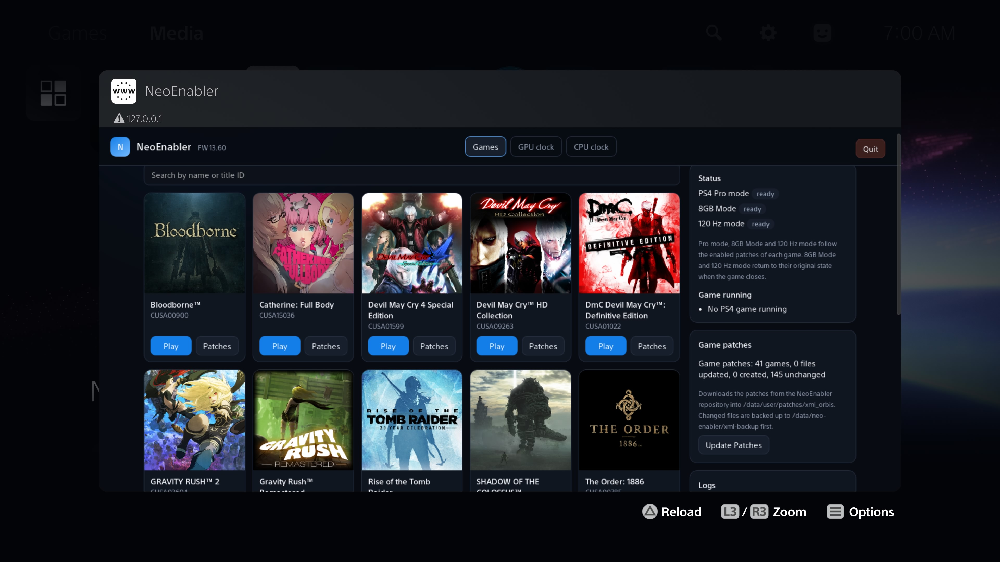
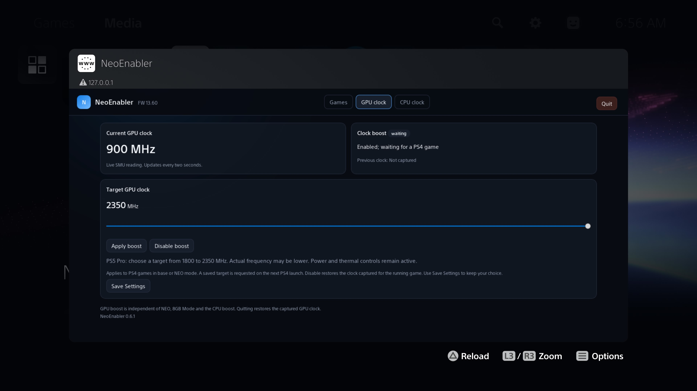
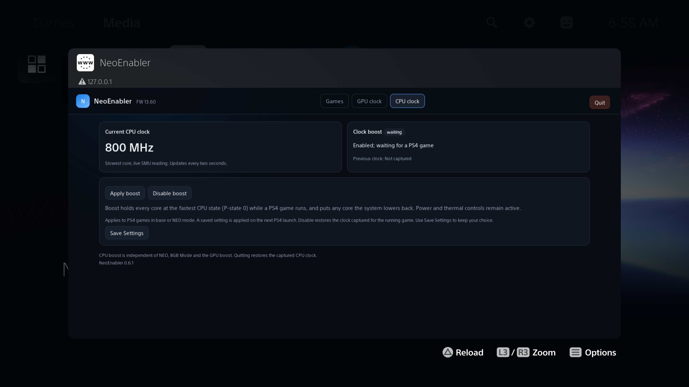

# NeoEnabler

Play PS4 games on your PS5 in **PS4 Pro mode** at higher resolutions, up to native 4K.

The PS5 already runs PS4 games that have PS4 Pro support in Pro mode. Games without it run as on a regular PS4.
NeoEnabler makes those games start as if they were on a PS4 Pro (games with Pro support are left as they are). This
alone does not make any game work: every game tested so far broke in Pro mode without its patch (black or
corrupted image, or the game closing). The patches in `xml/` fix each game for Pro mode and raise its resolution,
so NeoEnabler is only useful for the games listed below.

You pick the patches in the NeoEnabler panel. A game starts in Pro mode, and gets the 8 GiB memory budget, only
when one of its enabled patches needs it; every other game starts as usual.

Version 0.3.5 supports the 8 GiB memory budget without an HV unlock on firmware 13.20 and 13.60 with 10.01 and 12.70 being experimental.
See [validation and limitations](docs/8GB-NO-HV-1360.md): 13.20 has a Bloodborne gameplay and restoration test;
13.60 has community reports of Bloodborne 4K gameplay with 8 GiB enabled and a successful launch after the availability fix.
8 GiB support on firmware 10.01, 12.20 and 12.70 is **experimental**. On 12.20, one console test of Bloodborne
(CUSA00900) confirmed 8 GiB on launch and restoration of the stock DATA extension after closing the game.
10.01 and 12.70 each have one community report of Bloodborne running with 8 GiB enabled.
If you are on one of these firmwares, please report whether it works with the
[Test result form](https://github.com/gasb07/NeoEnabler/issues/new?template=test-result.yml).

## What you need

- A jailbroken PS5 on firmware 4.00 to 13.60 (tested on 13.20 and 13.60) with an ELF loader, such as etaHEN or elfldr.
- [ps-patch-system](https://github.com/illusionyy/ps-patch-system), loaded **before** NeoEnabler.

> [!IMPORTANT]
> **Load [ps-patch-system](https://github.com/illusionyy/ps-patch-system) first, then NeoEnabler, after every
> console boot.** NeoEnabler hooks into ps-patch-system and installs nothing without it: the panel then shows
> "ps-patch-system not loaded" and no game starts in PS4 Pro mode. If you loaded NeoEnabler first, load
> ps-patch-system, quit NeoEnabler in the panel and send `neo-manager.elf` again.

## Install

1. Download `neo-manager.elf` from the [latest release](https://github.com/gasb07/NeoEnabler/releases/latest).
2. After every console boot, load [ps-patch-system](https://github.com/illusionyy/ps-patch-system) **first**,
   then send `neo-manager.elf` with your payload sender (port 9021).
3. A notification on the PS5 confirms that NeoEnabler is enabled. It downloads the game patches from this
   repository and adds them to the ps-patch-system files (see [Game patches](#game-patches)).
4. Open the panel and tick the patches you want for each game.

The **8 GiB PS4 Pro memory budget** follows patches marked "8 GiB" in the panel.
This mode requires:

- **Firmware 13.20** or **13.60**.
  **10.01, 12.20 and 12.70 are experimental**: the manager refuses the 8 GiB launch if the firmware does not match what it
  expects, but a wrong value could still freeze the console.
- A running NeoEnabler manager and the validated ShellCore launch hook. The DATA path does **not** require an HV
  unlock and does not read or patch kernel TEXT.

Start from a reboot and load the jailbreak and ps-patch-system before this build. Do not mix it with an older
8 GiB memory payload or an existing kernel TEXT memory patch in the same boot. Close the game before quitting
the manager. If a guard refuses a launch or reports a recovery failure, read the memory status before retrying.

When either condition is missing, patches that need 8 GiB are greyed out and cannot be enabled. Everything else
works without 8 GiB.

NeoEnabler must keep running for the automatic Pro mode and 8 GiB: send it again after every reboot.

## Control panel

Open `http://<PS5 IP>:8765` in a browser on your network, or the **NeoEnabler** shortcut in the PS5 Media tab.

- **Games**: every installed PS4 game that has a NeoEnabler patch for its installed version, with its icon, title
  ID, version and all of its patches. Tick a patch to enable it; the change goes straight to the ps-patch-system
  settings, there is nothing to save. Only one NeoEnabler resolution entry per game can be on: ticking one turns
  the others off. In a collection, each game in it can have one resolution on. The collection starts in its
  first game, so the other games' resolutions need one of the first game: the panel ticks it for you.
  **Collections need NeoEnabler 0.3.3 or newer.** Older versions keep only one resolution per title ID, and their
  patch sync replaces the entry of one game with another game's entry of the same name. Patches
  that need 8 GiB are marked and greyed out when 8 GiB is not available.
  Use the search bar to find a game by name or title ID.
- **PS4 Pro mode and 8 GiB are automatic.** When a PS4 game starts, NeoEnabler checks its enabled patches: the
  game starts in PS4 Pro mode only when one of them needs it, and 8 GiB is switched on before the game starts
  only when one of them needs it. 8 GiB returns to the original 5.25 GiB budget after the game closes.
- **Status**: PS4 Pro mode of the running game, 8 GiB state and the running game.
- **Game patches**: Update Patches downloads the patches from this repository (also done at startup).
- **Logs**: Show Logs, Download Logs, Save Logs and Save Diagnostic. They give one text with a report of the
  console, NeoEnabler's own log (`/data/neo-enabler/neo.log`) and the kernel log kept in
  `/data/neo-enabler/kernel.log`.
- **Advanced** (collapsed): Pro mode for every PS4 game, or 8 GiB kept on, regardless of the patches.

Quitting the manager stops the automatic Pro mode and 8 GiB until it runs again. Rebooting removes the hook.
A failed kernel-write recovery of the memory budget requires a console reboot before launching games.

Anyone on your local network can open the panel.

### GPU clock tab

Open **GPU clock** in the panel, select a target from **1800 to 2350 MHz** in 50 MHz steps, and use
**Apply boost**. The current clock reported by the SMU updates every two seconds. The target and enable flag
are saved with **Save Settings** and requested again when a PS4 game starts. 2350 MHz is for the PS5 Pro, 2200 MHz is the maximum for the standard PS5.
This works independently of CPU boost, NEO and 8 GiB, including PS4 base mode.

GPU boost is **off by default**, with 2200 MHz selected. It is confirmed working on **firmware 13.20 and 13.60** and uses the stock
`/dev/mp1` driver, without patching the kernel or needing a hypervisor exploit. The sustained frequency may be
lower than the target. A short gameplay test at 2200 MHz read around 2155-2200 MHz. FPS gains and long-term
stability have not been established.

**Disable boost** and **Quit** restore the clock the game had before boost. When the game closes, the system
manages the clocks again, and the next PS4 launch starts from a new baseline. If the clock is reset to 1800 MHz
while the game runs, the manager restores the target up to three times. If a request or restoration fails, the
panel shows the error and stops retrying: use Disable to retry the restoration before enabling again.

Boost does not change CPU clocks, thermal or power limits, memory bandwidth or ROPs. On other firmwares, or when
the MP1 driver does not answer, the GPU clock tab is not shown.

### CPU clock tab 

Open CPU clock in the panel and use Apply boost. While a PS4 game runs, boost holds every core at the fastest CPU state (P-state 0) and puts back any core the system lowers. The current clock shows the slowest core, read live from the SMU, and updates every two seconds. Power and thermal controls remain active. The enable flag is saved with Save Settings and applied again when the next PS4 game starts. Until then the panel shows Enabled; waiting for a PS4 game, with the previous clock listed as Not captured. It applies to PS4 games in base or NEO mode.  This works independently of NEO, 8 GiB mode and the GPU boost.

The standard clock speed when running ps4 games on PS4 is 2.84 Ghz. Boost will force the CPU to run at a minimum of 3.2 GHz and maximum of 3.5 GHz. There is no way to know for sure what the CPU is running at because the SMU keeps it a secret but the Kernel does know what P state the CPU is in and it has 3.2 ghz as the reference for P-state 0. 

CPU boost is **off by default**. It is confirmed working on firmware 13.20 and 13.60 and uses the stock /dev/mp1 driver, without patching the kernel or needing a hypervisor exploit. The sustained frequency may be lower than P-state 0 because power and thermal controls remain active. A short gameplay test read [measured clock]. FPS gains and long-term stability have not been established.

Disable boost and Quit restore the CPU clock captured for the running game. When the game closes, the system manages the clocks again, and the next PS4 launch captures a new baseline. If a request or restoration fails, the
panel shows the error and stops retrying: use Disable to retry the restoration before enabling again.

Boost does not change GPU clocks, thermal, or power limits. On other firmwares, or when
the MP1 driver does not answer, the GPU clock tab is not shown.

## Game patches

Every game needs its patch from `xml/` to work in PS4 Pro mode. NeoEnabler installs them for you:

1. At startup (and with **Update Patches** in the panel), NeoEnabler downloads `xml/` from this repository and adds
   its entries to every ps-patch-system file of the same game in `/data/user/patches/xml_orbis/` (all regions,
   matched by the game title). Entries already there are updated; other patches in those files are kept. An entry
   with the same patch lines under another name is renamed to the repository name, and stays enabled if it was. A
   game without a file gets a new `<TITLE ID>.xml`. Changed files are backed up first to
   `/data/neo-enabler/xml-backup/<date-time>/` (the last 5 backups are kept).
2. In the panel's Games page, tick **one** resolution entry for the game, for example "Native 4K (PS4 Pro mode)".
3. For 4K entries, set the PS5 video output to 2160p.

Every NeoEnabler entry carries `NeoRequires="pro"` or `NeoRequires="pro,8gib"`, which tells the manager what the
game needs at launch. `NeoRequires="120hz"` (alone or with the others, for example `pro,120hz`) marks an entry that
runs the game at 120 fps: starting a game that has it enabled turns on the 120 Hz video output, and closing the game
turns it off again (unless you had turned it on yourself in Advanced). Entries without the attribute are also
recognised when "120 FPS" or "120 Hz" is in their name. ps-patch-system ignores this attribute.

Supported games, resolutions and notes: [docs/GAMES.md](docs/GAMES.md).

Patch IDs, how the hook works and how to build from source: [docs/TECHNICAL.md](docs/TECHNICAL.md).

Test results by game and firmware: [docs/COMPATIBILITY.md](docs/COMPATIBILITY.md). Report yours with the
[Test result form](https://github.com/gasb07/NeoEnabler/issues/new?template=test-result.yml).

## Credits

### Code and tools

| Project | Author | Used for |
| --- | --- | --- |
| [ps5-payload-sdk](https://github.com/ps5-payload-dev/sdk) | [John Törnblom](https://github.com/john-tornblom) | Toolchain (`prospero-clang`, `ld.lld`), runtime with `kernel_proc_copyin/out` and `kernel_dynlib_*`, `prospero-deploy` |
| [elfldr](https://github.com/ps5-payload-dev/elfldr) | [ps5-payload-dev](https://github.com/ps5-payload-dev) ([John Törnblom](https://github.com/john-tornblom)) | ELF loader on port 9021 |
| [ps-patch-system](https://github.com/illusionyy/ps-patch-system) | [illusion](https://github.com/illusionyy) | Patch server, XML format, the `getAppInfo` hook the shim chains onto, call site patterns and `ATTRIBUTE` offsets. `src/dynlib.h` and `src/proc.h` copied from `shared/` |
| [ps5-app-dumper](https://github.com/EchoStretch/ps5-app-dumper) | [EchoStretch](https://github.com/EchoStretch) | Reference for the `libSceAppInstUtil` load order and the Media tab shortcut (`deeplinkUri`) |
| [etaHEN](https://github.com/etaHEN/etaHEN) | [LightningMods](https://github.com/LightningMods) | Jailbreak, ELF loader, FTP and klog used during development and testing |
| [Pillow](https://github.com/python-pillow/Pillow) | [python-pillow](https://github.com/python-pillow) | Icon generation (`tools/make_icon.py`) |
| [ShadowMountPlus](https://github.com/drakmor/ShadowMountPlus) | [drakmor](https://github.com/drakmor) | Visual style of the games page (colors and layout of its web library) |

### Game patches

| Patch | Author | Source |
| --- | --- | --- |
| Alien: Isolation: 1440p, 1620p, 1800p, Native 4K resolution patches, 60 FPS, 120 FPS | gasb07 | |
| Batman: Arkham Knight: 1620p, 1800p, Native 4K resolution patches | gasb07 | |
| Battlefield 4: 1440p, 1620p, 1800p, Native 4K resolution patches | gasb07 | |
| Battlefield Hardline: 1440p, 1620p, 1800p, Native 4K resolution patches | gasb07 | |
| Bayonetta: Native 4k resolution patch | [Criminal](https://github.com/TheaCriminal) | |
| Bloodborne: Resolution Patch WxH, base of the NEO 1440p/1620p entries | [Kyo](https://github.com/Kyoskii) | [shadps4-emu/ps4_cheats](https://github.com/shadps4-emu/ps4_cheats/blob/main/PATCHES/Bloodborne.xml) |
| Bloodborne: 1440p, 1620p, 1800p, Native 4K resolution patches; 1800p/4K require 8 GiB mode | [Kyo](https://github.com/Kyoskii), gasb07 | |
| Dark Souls III: The Fire Fades Edition: 1440p, 1620p, 1800p, Native 4K resolution patches; 4K requires 8 GiB mode | DanielSvoboda, gasb07 | |
| Dead Island - Definitive Edition: 1440p, 1620p, 1800p, Native 4K resolution patches | gasb07 | |
| DEVIL MAY CRY 4 Special Edition: 1440p, Native 4K resolution patches, 120 FPS patch | [Criminal](https://github.com/TheaCriminal) | |
| Devil May Cry HD Collection: 4K patches for all three games, 120 FPS patch for DMC3 | [Criminal](https://github.com/TheaCriminal) | |
| Dishonored: Definitive Edition: 1440p, 1800p, Native 4K resolution patches, 60 FPS patch with triple buffering | gasb07, [illusion](https://github.com/illusionyy) | |
| Dishonored 2: 1620p, 1800p, Native 4K resolution patches, 60 FPS cap, skip intro videos | gasb07 | |
| DmC Devil May Cry: Definitive Edition: 1440p, 1800p, Native 4K resolution patches | [Criminal](https://github.com/TheaCriminal) | |
| Dragon Age: Inquisition: 1440p, 1620p, 1800p, Native 4K resolution patches, 60 FPS, 120 FPS | gasb07, [illusion](https://github.com/illusionyy) | |
| Dragon's Dogma: Dark Arisen: Native 4K resolution patch | gasb07 | |
| DRAGON QUEST XI S: 1440p, 1620p, 1800p, Native 4K resolution patches | gasb07 | |
| Driveclub: 1440p resolution patch; 4K output with 1620p/1800p rendering | gasb07 | |
| The Evil Within: 1440p, 1800p, Native 4K resolution patches; 4K requires 8 GiB mode | gasb07 | |
| The Evil Within 2: 1620p, 1800p, Native 4K resolution patches; 4K requires 8 GiB mode | gasb07 | |
| Final Fantasy XV: 1440p and 1944p resolution patches, 60 FPS High/Steady mode | [Criminal](https://github.com/TheaCriminal) | |
| God of War III: 1440p, 1800p, Native 4K resolution patches, 120 FPS | ibraaaaa2792 (resolution sites: kvicken + cuesta4) | |
| Gravity Rush Remastered: 1440p and 4K resolution patches, 120 FPS | [Criminal](https://github.com/TheaCriminal), [Junmin Lee](https://github.com/junminlee2004) | gasb07 Neo Findings |
| Gravity Rush 2: 1440p, 1620p, 1800p, Native 4K resolution patches, 60 FPS | [Criminal](https://github.com/TheaCriminal), gasb07, [illusion](https://github.com/illusionyy) | |
| inFAMOUS Second Son: 4K checkerboard resolution patch | gasb07 | |
| Just Cause 3: 1440p and Native 4K resolution patches, offline mode patch to skip online login | gasb07 | |
| KILLZONE SHADOW FALL: 1440p, 1620p, 1800p, Native 4K resolution patches | gasb07 | |
| Mad Max: 1440p, 1800p, Native 4K resolution patches | gasb07 | |
| MediEvil: 1440p, 1800p, 120HZ, Native 4K patches | [Criminal](https://github.com/TheaCriminal) | |
| METAL GEAR SOLID V: THE PHANTOM PAIN: 1440p, 1620p, 1800p, Native 4K, 4K checkerboard resolution patches | gasb07 | |
| Middle-earth: Shadow of Mordor - Game of the Year Edition: 1440p, 1620p, 1800p, Native 4K resolution patches | gasb07 | |
| Need for Speed: Rivals: 1440p and Native 4K resolution patches | gasb07 | |
| NieR:Automata: 1440p, 1620p, 1800p resolution patches | gasb07 | |
| The Order: 1886: 60 FPS Unlock, used by the Native 4K 60fps entry | [illusion](https://github.com/illusionyy) | PS-Game-Patch, `patches/xml/TheOrder1886-Orbis.xml` |
| The Order 1886: Native 4K resolution patch, Native 4K 60 FPS patch | gasb07, [illusion](https://github.com/illusionyy), gasb07 | |
| Prey: 1620p, 1800p, Native 4K resolution patches, 60 FPS cap, skip intro videos | gasb07 | |
| Ratchet and Clank: 1728p, 1872p, Native 4K resolution patches | gasb07 | |
| Rayman Legends: 1440p, 1620p, 1800p, Native 4K resolution patches | gasb07 | |
| Red Dead Redemption 2: 4k, 60 FPS, Skip Intro | [Criminal](https://github.com/TheaCriminal), Illusion, Jao  | PS Game Patch |
| RESIDENT EVIL 5: 1440p and Native 4K resolution patches + 120 FPS | [Criminal](https://github.com/TheaCriminal) | |
| RESIDENT EVIL 6: 1440p and Native 4K resolution patches | gasb07 | |
| Rise of the Tomb Raider: 1440p, 1800p, 4k, 120FPS | [Criminal](https://github.com/TheaCriminal) | |
| Senran Kagura Estival Versus: 1440p and Native 4K resolution patches | [Criminal](https://github.com/TheaCriminal) | |
| Shadow of the Colossus: 1620p, 1800p, Native 4K resolution patches, debug menu, skip splash logo/demo screens, 60 FPS patch | gasb07, [illusion](https://github.com/illusionyy) | |
| Sleeping Dogs: Definitive Edition: 1440p, 1620p, 1800p, Native 4K resolution patches; 60 FPS variants for each resolution | gasb07, [illusion](https://github.com/illusionyy) | |
| Spyro Reignited Trilogy: 1620p, 1800p, Native 4K resolution patches | Shane O'Reilly | |
| Thief: 1440p, 1620p, 1800p, Native 4K resolution patches, 60 FPS | gasb07 | |
| Titanfall 2: 1620p, 1800p, Native 4K resolution patches | gasb07 | |
| Tomb Raider: Definitive Edition: 1440p, 1620p, 1800p, Native 4K resolution patches | gasb07 | |
| Uncharted: Drake's Fortune Remastered: 1440p, 1620p, 1800p, Native 4K resolution patches; 4K options with standard or full texture quality (8 GiB mode) | gasb07 | |
| Uncharted 2: Among Thieves Remastered: 1440p, 1620p, 1800p, Native 4K resolution patches; 4K options with standard or full texture quality (8 GiB mode) | gasb07 | |
| Uncharted 3: Drake's Deception Remastered: 1440p, 1620p, 1800p, Native 4K resolution patches; 4K options with standard or full texture quality (8 GiB mode) | gasb07 | |
| Watch Dogs: 1440p, 1620p, 1800p, Native 4K resolution patches, 60 FPS patch, 60 FPS patch with triple buffering | gasb07 | |
| Watch Dogs 2: 1440p, 1620p, 1800p, Native 4K resolution patches, 60 FPS, 120 FPS | gasb07 | |
| Yakuza 6: The Song of Life: 1440p, 1620p, 1800p, Native 4K resolution patches; 60 FPS patch; 4K requires 8 GiB mode | gasb07 | |

Entries with author "gasb07" (Pro mode, resolutions, JC3 offline mode) and the NEO fixes inside the
Bloodborne resolution entries were made in this project.

## License

GPL-3.0 (`LICENSE`). The payload includes the ps5-payload-sdk runtime (GPL-3.0-or-later), so
the binary must be distributed under GPL-3.0.

Third-party files keep their own licenses:

- `src/dynlib.h`, `src/proc.h`: Apache-2.0 (ps-patch-system), compatible with GPL-3.0.
- The Bloodborne resolution code from shadps4-emu/ps4_cheats: the repository declares no license. It is included
  with attribution to its author.
